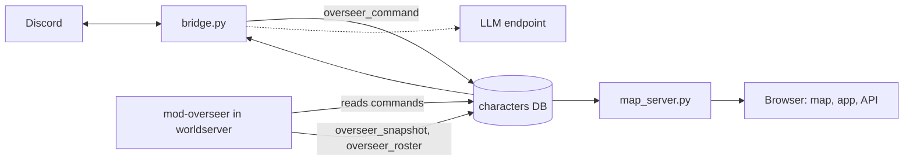

# wow-overseer

The Discord bridge and live web site for a World of Warcraft server run by bots.

It lets an operator steer playerbots on an AzerothCore server in plain
language from Discord, keeps the goals it is given, and shows the world on a
live map and operations site. It is the other half of
[mod-overseer](https://github.com/quadseven/mod-overseer): the module runs
inside the worldserver, and this service is the only thing that writes its
commands and renders what it records.

## What it does

1. An allowed Discord user addresses a bot, for example `@Name follow`, and
   the bridge turns it into a command row the module delivers to that bot.
2. Goals, guild runs, crafting, questing and raid preparation persist and are
   driven forward on timers, with in-character chatter relayed back to
   Discord.
3. A browser shows a live map of the world, the operations app, and a
   read-only API (`/api/...` and `/api/v2/...`, listed in
   [docs/API.md](docs/API.md)).

## Quick start

You need an AzerothCore worldserver with
[mod-overseer](https://github.com/quadseven/mod-overseer) loaded and its MySQL
server reachable.

```sh
git clone --recurse-submodules https://github.com/quadseven/wow-overseer.git
cd wow-overseer
docker build -t wow-overseer .
# The bridge, without Discord:
docker run --rm -e MYSQL_HOST=db.example.internal \
  -e MYSQL_ROOT_PASSWORD=change-me -e OVERSEER_HEADLESS=1 wow-overseer
# The map and operations site on port 8080:
docker run --rm -p 8080:8080 -e MYSQL_HOST=db.example.internal \
  -e MYSQL_ROOT_PASSWORD=change-me wow-overseer python -u map_server.py
```

Drop `OVERSEER_HEADLESS` and set `DISCORD_BOT_TOKEN` and
`DISCORD_ALLOWED_USERS` to take orders from Discord.

## How it works



`bridge.py` is the entrypoint (`CMD` in the `Dockerfile`). It parses Discord
orders, writes `overseer_command` rows, and runs the timed loops (goals,
guild runs, crafting, relay of world chat) that read the module's snapshot
and roster tables. `map_server.py` serves the live map, the operations app in
`app/` and the read API in `apiv2/`. An LLM endpoint is optional and only
voices chatter and decisions.

Python modules sit flat at the repo root and are copied into the image one by
one. `tests/` is the unit suite; part of it reads
`mod-overseer/src/mod_overseer.cpp` as text, which is why `mod-overseer/` is a
pinned submodule that only the tests use. `tools/` holds maintenance scripts
and is not in the image.

## Run and test locally

These are the commands `check.yml` runs, from the repo root:

```sh
git submodule update --init
python3 .github/scripts/check_mod_overseer_pin.py
python3 .github/scripts/check_fork_pin_parity.py
python3 .github/scripts/compile_check.py --min-python 3.12
uv run --no-project --python 3.12 --with-requirements tests/requirements.txt python3 .github/scripts/unittest_parallel.py
uvx ruff@0.15.10 check .
uvx ruff@0.15.10 format --check .
```

The first check fails when the submodule pin is not an ancestor of the module's
main branch; it fetches that branch, so it needs network access. The second
fails when the vendored `AC_MODULE_SHA` differs from the deploy repo's; it reads
that file with `gh api` and says so and skips when the file is not readable.

`python3 -m unittest discover -s tests -p 'test_*.py'` also works and runs
the suite on one core. `build.yml` builds the image on every pull request and
pushes `ghcr.io/quadseven/wow-overseer:sha-<12-char-sha>` on a push to `main`.

## Configuration

All settings are environment variables. Most have defaults; these are the
ones a stranger must supply or will want first.

| Setting | What it does |
|---|---|
| `MYSQL_HOST` | Host of the AzerothCore MySQL server (default `mysql`). |
| `MYSQL_ROOT_PASSWORD` | Password the bridge and site connect with. Required. |
| `DISCORD_BOT_TOKEN` | The Discord bot token. Required unless headless. |
| `DISCORD_ALLOWED_USERS` | Comma-separated Discord user IDs allowed to give orders. |
| `DISCORD_REPORT_USERS` | Comma-separated Discord user IDs allowed to give report orders only (`stats`, `quests`, `talents`, `los`, roster and digest questions). Orders that would change the world are refused. For a bot identity that may ask after the family but never move it; never a substitute for `DISCORD_ALLOWED_USERS`. |
| `OVERSEER_HEADLESS` | `1` runs the bridge loops with no Discord connection. |
| `OVERSEER_CHANNEL_ID`, `CHAT_CHANNEL_ID` | Channels the bridge acts in; empty means every channel. |
| `PORT` | Port `map_server.py` listens on (default `8080`). |
| `LLM_URL`, `LLM_MODEL` | An OpenAI-compatible chat endpoint for chatter. Set your own. |
| `WOW_STREAM_PREFIX` | Broadcast prefix for this realm; empty means no videos. |

Set `WOW_STREAM_PREFIX` per realm; it never falls back to another realm's
prefix. `WOW_STREAMED_CHARACTERS` can narrow which characters have a video.

Not shipped here: the AzerothCore server with mod-overseer, its database, a
Discord application, an LLM endpoint, and any cluster or video encoder you
deploy into. `tools/realm_roller_example/` shows the shape of the release and
channel files the realm roller reads, with placeholder values.

## Status

Open work is tracked in the goal issue
[Goal: our guild one-shots Ragnaros](https://github.com/quadseven/wow-overseer/issues/512).

## Contributing

Changes land through a pull request; direct pushes to `main` are refused. A
pull request must pass `check.yml` (compile check, unit tests, ruff),
`build.yml` (image build) and `check.leak-scan.yml` (public text scan), and
the `grug-tribe[bot]` review. Read [AGENTS.md](AGENTS.md) first: this
repository is public.

## The Watcher (observer camera)

`director.py` points one invisible, flying GM character at whoever the
operator names, so its stream shows them. It queues moves as
`overseer_command` rows of kind `gm` for that character, and its allow-list
(`director.observer_allows`) holds only observer commands.

Orders come from Discord (in the overseer channel, from an allowed user) or
`POST /api/director {"watch": "<order>"}` with the `X-Director-Token` header:

```text
watch <character> | family [key] | guild <name> | run <id>
  | dungeon <keyword> | bg | raid | off
```

An order lapses after 30 minutes unless renewed. `GET /api/director` shows
the order and what the Watcher is doing.

| Variable | Meaning |
|---|---|
| `OVERSEER_WATCHER_NAME` | The observer character's name (default `Watcher`). |
| `OVERSEER_DIRECTOR_TOKEN` | Key for the HTTP order. Unset closes the HTTP door. |
| `WATCH_CYCLE_SECONDS` | How often the director decides (default 3). |
| `WOW_STREAMED_CHARACTERS` | Must list the observer for the site to show its card. |

The character, its game account and the client that logs it in are the
deployment's to provide.

## Realm roller

`realmroller.py` and `realmroller_world.py` hold the release and channel file
formats, the pure decision of what a realm rolls to next, and its gate
readers. `realmroller_plan.py` plans the one roll commit, and
`realmroller_act.py` holds the GitHub, Kubernetes and status adapters a
scheduled job runs as `python3 realmroller_act.py ...`. A paused channel acts
on nothing. `tools/realm_roller.py` is a dry run. The bridge does not import
these modules.

## Metric snapshots

`tools/metric_watcher.py` reads the versioned API and appends one aggregate
JSON object per guild to a JSON Lines file: level gains, measured XP per hour,
dungeon runs, class quests, deaths, stuck and offline members, and each
crafter's profession skills. It writes no member names and uses no write
endpoint. When the site's `METRIC_WATCHER_OUTPUT` points at the same file,
the Raid tab shows alchemy progress and projected dates.

The units under `systemd/` run it every 30 minutes as the `wow-overseer`
account from `/opt/wow-overseer`:

```sh
sudo install -d -o wow-overseer -g wow-overseer /var/lib/wow-overseer
sudo install -D -m 0644 systemd/metric-watcher.env.example \
  /etc/wow-overseer/metric-watcher.env
sudoedit /etc/wow-overseer/metric-watcher.env
sudo install -D -m 0644 systemd/metric-watcher.service \
  /etc/systemd/system/metric-watcher.service
sudo install -D -m 0644 systemd/metric-watcher.timer \
  /etc/systemd/system/metric-watcher.timer
sudo systemctl daemon-reload
sudo systemctl enable --now metric-watcher.timer
```

`--api-root` and `--output`, or `METRIC_WATCHER_API_ROOT` and
`METRIC_WATCHER_OUTPUT`, set the API root and output path.

## History

Where this repository came from, and what stayed behind in the split, is in
[docs/HISTORY.md](docs/HISTORY.md).
