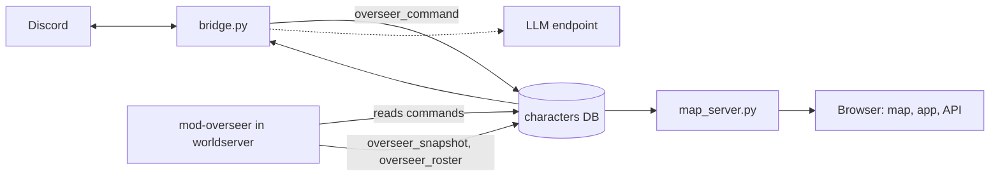

# wow-overseer

The Discord bridge and live web site for a World of Warcraft server run by bots.

Last checked against the code: 2026-11-01.

An operator steers playerbots on an AzerothCore server in plain language from Discord, and a live map and operations site show the world. [mod-overseer](https://github.com/quadseven/mod-overseer) runs inside the worldserver. This service writes its commands and renders what it records.

## What it does

1. An allowed Discord user addresses a bot, for example `@Name follow`. The bridge writes an `overseer_command` row that the module delivers.
2. Goals, guild runs, crafting, questing and raid preparation persist and advance on timers. Chatter is relayed to Discord.
3. A browser gets the live map, the operations app and an API. GET routes are listed in [docs/API.md](docs/API.md). `map_server.py` also takes POST on `/api/chat`, `/api/decree`, `/api/watch`, `/api/director` and `/api/frame`.

## Quick start

You need an AzerothCore worldserver with mod-overseer loaded and its MySQL server reachable. Unverified: these commands were checked against the `Dockerfile` and code only, not run.

```sh
git clone --recurse-submodules https://github.com/quadseven/wow-overseer.git
cd wow-overseer
docker build -t wow-overseer .
docker run --rm -e MYSQL_HOST=db.example.internal -e MYSQL_ROOT_PASSWORD=change-me \
  -e OVERSEER_HEADLESS=1 wow-overseer
docker run --rm -p 8080:8080 -e MYSQL_HOST=db.example.internal \
  -e MYSQL_ROOT_PASSWORD=change-me wow-overseer python -u map_server.py
```

The first `docker run` is the bridge without Discord. The second is the site on port 8080.

## How it works



`bridge.py` is the image entrypoint. The same image also runs `map_server.py` and the scheduled `tools/metric_watcher.py` collector with different commands.

## Run and test locally

`scripts/check-locally.sh all` runs both CI jobs. It needs `uv` and `python3` 3.12 or newer. These are the commands behind it:

```sh
git submodule update --init
python3 .github/scripts/check_mod_overseer_pin.py
python3 .github/scripts/check_fork_pin_parity.py
python3 .github/scripts/compile_check.py --min-python 3.12
uv run --no-project --python 3.12 --with-requirements tests/requirements.txt python3 .github/scripts/unittest_parallel.py
uvx ruff@0.15.10 check .
uvx ruff@0.15.10 format --check .
```

The pin check fetches the module's main branch, so it needs network access. The parity check skips with a message when it cannot read the private deploy repo. A bare `unittest` run without the submodule and pinned requirements reports failures that CI never sees.

## Configuration

Settings are environment variables. These are the ones to set first.

| Setting | What it does |
|---|---|
| `MYSQL_HOST` | MySQL host (default `mysql`). |
| `MYSQL_ROOT_PASSWORD` | Database password. Required. |
| `DISCORD_BOT_TOKEN` | Discord bot token. Required unless headless. |
| `DISCORD_ALLOWED_USERS` | Discord user IDs allowed to give orders. Required unless headless. |
| `DISCORD_REPORT_USERS` | Discord user IDs limited to report orders. |
| `OVERSEER_HEADLESS` | `1` runs the bridge loops with no Discord connection. |
| `OVERSEER_CHANNEL_ID`, `CHAT_CHANNEL_ID` | Channels the bridge acts in. Empty means every channel. |
| `PORT` | Port of `map_server.py` (default `8080`). |
| `LLM_URL`, `LLM_MODEL` | OpenAI-compatible chat endpoint. Set your own: the `LLM_URL` default is private. |
| `WOW_STREAM_PREFIX` | Broadcast prefix for this realm. Empty means no videos. |

## Status

Live. The bridge and site run as two deployments in the `wow-dev` namespace, the only realm left. The site is reachable only on the operator's private network, through a reverse proxy.

- Open work: [Goal: our guild one-shots Ragnaros](https://github.com/quadseven/wow-overseer/issues/512).
- Stubbed: `services/strands-decider` is built and deployed at zero replicas. The realm roller job is suspended on an older image.
- Retired: the `wow` and `wow-hardcore` realms.
- Metric snapshots require a scheduled `tools/metric_watcher.py` process and a JSONL file shared with the site. Scheduled collection still needs runtime verification.

## Contributing

Changes land through a pull request. The ruleset requires `Grug - Chief` and `Grug - Elder`. `check.yml`, `build.yml` and `check.leak-scan.yml` are not required by the ruleset, but the merge gate in [AGENTS.md](AGENTS.md) binds them. `check.yml` and `build.yml` have path filters, so a Markdown-only pull request runs neither. Read AGENTS.md first: this repository is public.

## How it deploys

A merge deploys nothing.

1. A push to `main` that touches the image paths makes `build.yml` publish `ghcr.io/quadseven/wow-overseer:sha-<12>`. The image needs credentials to pull; an anonymous pull got 403.
2. A scheduled job in the private deploy repo checks every 20 minutes and opens a pin pull request for the new digest. It never merges, and it skips changes that stay out of the image.
3. Landing that pull request restarts the `wow-overseer` and `wow-map` deployments.

A worldserver roll is separate and logs every bot out. [docs/ROLLS.md](docs/ROLLS.md) is the whole procedure.

## Layout

- Repo root: flat Python modules, listed by hand in the `Dockerfile`.
- `app/`, `index.html`: the operations site.
- `apiv2/`: the versioned API.
- `tests/`: the unit suite.
- `tools/`, `scripts/`: maintenance and local checks. Only the scheduled metric watcher and its audit dependency ship in the image.
- `mod-overseer/`: pinned submodule, read as text by tests only.
- `patches/`, `UPSTREAM-PINS.env`: test fixtures, not build inputs.
- `services/strands-decider/`: a separate image.
- `systemd/`: units for the metric watcher.

## Docs

- [docs/API.md](docs/API.md): GET routes.
- [docs/ROLLS.md](docs/ROLLS.md): how to ship.
- [docs/OPERATIONS.md](docs/OPERATIONS.md): the Watcher camera, realm roller and metric snapshots.
- [docs/HISTORY.md](docs/HISTORY.md): where this repository came from.
- [AGENTS.md](AGENTS.md): rules for agents.
